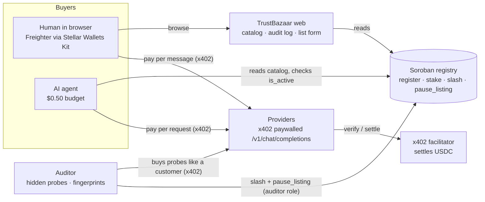

# TrustBazaar

**A marketplace where AI agents and people pay per request for LLM inference on Stellar, and providers who lie about what they serve lose their stake.**

Built in 24 hours for HackMeridian 2026 (Genesis path, Stellar Composed). Everything runs on **Stellar testnet**.

## The problem

x402 lets anyone sell an API per request: no accounts, no API keys. Agents are starting to buy that way on their own. But a buyer can't tell whether the provider is honest: a seller can advertise a large model, serve a tiny one and keep the difference. Agents buying thousands of requests won't notice. Today's catalogs list services; nobody verifies them.

## How it works



1. **Providers stake.** To list an endpoint, a provider declares the model it serves and a price, and locks USDC in the registry contract (`register`, `stake`).
2. **Buyers pay per request.** Humans pay from Freighter in the browser. The agent pays from its own wallet with a $0.50 budget. Payments go **directly to the provider** over x402 (Soroban auth-entry signing of a USDC transfer); TrustBazaar is never a middleman.
3. **The auditor catches liars.** It is a paying customer like any other. It sends randomized hidden probes:
   - *checkable* probes with known answers (multi-step arithmetic, strict formatting, extraction)
   - *fingerprint* probes, whose answers are embedded and compared with answers from reference models we can query (MiniMax-M2.7 via API, `llama3.2:3b` and `qwen2.5:0.5b` via Ollama)

   Score = 70% fingerprint match with the claimed model plus 30% checkable accuracy. A verdict needs at least 5 scored probes.
4. **Cheaters get slashed.** Below 60/100, the auditor (the only wallet holding the `auditor` role) calls `slash` (the full stake goes to the treasury) and `pause_listing`. The card turns red, then disappears, and the agent reroutes to an honest provider.

### Seed listings (all run by us)

| Listing | Claims | Actually serves | Price |
|---|---|---|---|
| Provider A | MiniMax-M2.7 | MiniMax API | $0.02 |
| Provider B | llama3.2:3b | Ollama llama3.2:3b | $0.004 |
| **CheapMax** (the cheater) | MiniMax-M2.7 | Ollama **qwen2.5:0.5b** | $0.012 |

Calibration over 3 rounds: Provider A scored 83/100/83, Provider B 70/85/85, and CheapMax 0/0/0 (every fingerprint probe matched qwen2.5:0.5b at similarity ≈1.0).

## Proof on testnet

- Registry contract: [`CAHJN3HANWQVJUPQO43PXLCCK4ZAA2Y2EOJYTI7WJAO4WYWFB34GSH2D`](https://stellar.expert/explorer/testnet/contract/CAHJN3HANWQVJUPQO43PXLCCK4ZAA2Y2EOJYTI7WJAO4WYWFB34GSH2D)
- First x402 payment (agent → provider): [`0ddff7b0…`](https://stellar.expert/explorer/testnet/tx/0ddff7b02f53dcfec78df221ed49c7a32b73118bc4e1c00d63aaf23f91ce4c74)
- Human payment from Freighter in the browser: [`5a602447…`](https://stellar.expert/explorer/testnet/tx/5a6024470f23f42c49ea21a0eeee8ac9f56074787e34f951e7430760d5e9b3b4)
- **CheapMax slashed by the auditor**: [`abfa5a43…`](https://stellar.expert/explorer/testnet/tx/abfa5a43b63a91bb5acf34b8025615d581624b1a8227c7e81cddc3422214fb4c), delisted: [`e6fcbae4…`](https://stellar.expert/explorer/testnet/tx/e6fcbae4e4730e06c409d1169d62aec8c4c4106f56560aa9b1b3f4ce6880cf30)

## Stellar integration

| Layer | What we use |
|---|---|
| Payments | x402 `exact` scheme on `stellar:testnet` (`@x402/express`, `@x402/fetch`, `@x402/stellar` 2.28), USDC SAC, fee-sponsored settlement |
| Contract | Soroban (soroban-sdk 28) with **OpenZeppelin Stellar Contracts 0.8**: Access Control (`auditor` role, `#[only_role]`), Pausable (registry-wide emergency stop) |
| Staking | Stellar Asset Contract (USDC) transfers into and out of the registry |
| Wallets | **Freighter** via Stellar Wallets Kit: `signAuthEntry` for x402, `signTransaction` for register/stake |

## Run it

Requirements: Node 25+, pnpm, Rust with `wasm32v1-none`, stellar-cli 28, Ollama, and a MiniMax API key.

```bash
pnpm install
ollama pull llama3.2:3b && ollama pull qwen2.5:0.5b && ollama pull nomic-embed-text
./scripts/setup-keys.sh                     # 7 testnet identities, funded, with USDC trustlines → .env
echo 'MINIMAX_API_KEY=…' >> .env
# send testnet USDC (faucet.circle.com): 6 to each provider, 1 to the auditor, 0.50 to the agent
pnpm check-env                              # balances, Ollama models, MiniMax key
./scripts/deploy-registry.sh                # deploys the contract, writes REGISTRY_CONTRACT_ID
pnpm seed                                   # registers and stakes the three listings
pnpm dev                                    # web :3000, providers :4001, auditor :4002
pnpm agent                                  # the agent buys a summary
pnpm agent --try-overspend                  # the budget rejects a $2.00 job
pnpm demo:reset                             # fresh CheapMax after a slash
```

Tests: `pnpm test` (59 TypeScript tests) and `cargo test -p registry` (11 contract tests). The video walkthrough is in [`docs/demo-runbook.md`](docs/demo-runbook.md).

## Honest limits

- **The audit is statistical.** It can produce false positives and false negatives. MiniMax answers vary between runs (one of Provider A's probes landed nearest qwen), which is why the score blends several probes and a verdict needs at least 5 of them.
- **A smart cheater could detect probes**, or forward probes to the real model while serving cheap answers to everyone else. Randomized prompts drawn from a pool, plus probes paid like normal traffic, reduce this but don't remove it.
- **We can only verify models we can query as a reference.** A listing that claims anything else (e.g. a closed model) is marked *Unverifiable* and is never slashed.
- **The seed providers are ours**, including the cheater. Providers and auditor references share one local Ollama instance; in production the reference would be hosted independently.
- **The agent's spending cap is enforced in the agent's code, off-chain.** The on-chain version (an OpenZeppelin smart account with a spending-limit policy) is blocked today by an x402 facilitator bug with policy events ([x402#3352](https://github.com/x402-foundation/x402/issues/3352)). The agent's wallet only holds $0.50, which bounds the worst case.
- **The facilitator is self-hosted** (in-process, built from the official x402 libraries, with our admin key paying fees) rather than the hosted OpenZeppelin facilitator, which requires an API key.
- **No unstake yet.** Stake can only be slashed; a withdrawal with a cooldown is future work.
- **Weather demo APIs are synthetic local fixtures.** `pnpm demo:weather` starts three endpoints on your machine and does not list them automatically. Submit one through `/list`; with `REGISTRY_MODE=onchain` the listing and stake are registered on Stellar Testnet and require wallet signatures. Requests to these fixtures use simulated x402 payments, so they do not move USDC and are excluded from earnings/spend. The dashboard reads confirmed USDC transfer events from Stellar Testnet RPC; RPC event history is limited to about seven days. Forecast values are fixtures, not real-world weather, and API-specific truth audits are future work.
- **Providers cannot self-pause in the registry.** The deployed registry only permits the auditor to call `pause_listing`. A provider can stop serving by disabling the API at its host; provider-controlled registry pause needs a contract change.
- **Wallets:** the live marketplace is on Stellar Testnet and currently uses Freighter. MetaMask's available Stellar adapter supports PUBNET only, so it cannot safely sign this app's Testnet payment or registry operations yet.
- **Testnet only.** Nothing here has been audited.

## What's next

- On-chain agent spending caps through OpenZeppelin smart accounts once the facilitator fix lands.
- Complete the weather API provider and auditor paths, then add more API categories only with explicit request/response contracts and category-specific audit rules.
- Reputation over time instead of single-round verdicts, unstake with a cooldown, and audits that third parties can run and challenge.
- A trust layer any x402 seller can plug into, not just this catalog.
