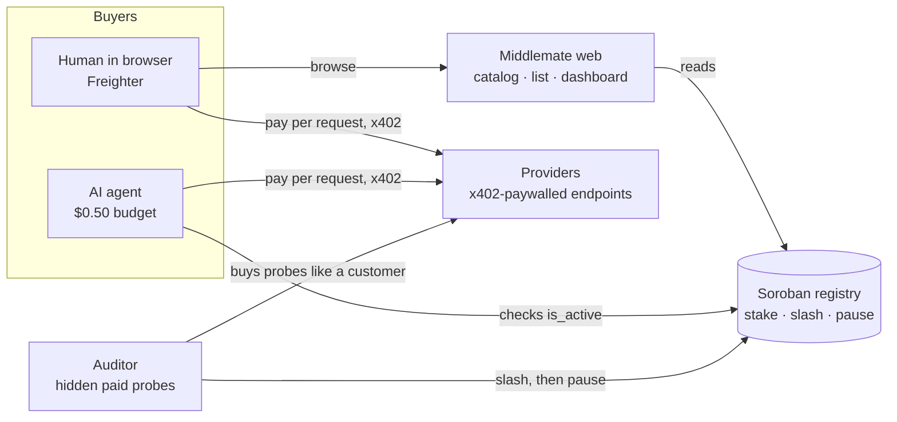

<p align="center">
  <picture>
    <source media="(prefers-color-scheme: dark)" srcset="docs/assets/middlemate-logo-dark.svg">
    
  </picture>
</p>

<h3 align="center">Pay per request. Liars get slashed.</h3>

<p align="center">A marketplace for pay-per-request AI and API endpoints on Stellar. Sellers stake USDC to list, an auditor buys from them in secret, and a seller who lies about what it serves loses its stake, on-chain.</p>

<p align="center"><b>HackMeridian 2026</b> · Genesis path · <b>Stellar Composed</b> track · runs on Stellar testnet · Curtis, Mathieu, Mohamed</p>

## The problem

AI agents now pay for compute on their own. With x402, any URL can sell to any agent per request, with no account and no API key. But a buyer can't check what it gets: a seller can claim a frontier model, serve a 0.5B one and keep the difference, and an agent buying thousands of requests will never notice. Catalogs list services; nobody verifies them.

## What we built

We found no Stellar-native x402 marketplace for inference, so we built one, with a security layer between buyers and sellers:

| Piece | What it does |
|---|---|
| **Paywall** | x402 in front of any OpenAI-compatible endpoint, paid in USDC on Stellar. The listed price is read from the endpoint's own 402 answer. |
| **Registry** | A Soroban contract holds every listing, its stake and its status. One wallet can run several listings, each staked on its own. |
| **Buyers** | People pay from Freighter in the browser. Agents pay from code under a spending cap, and only buy from listings that are active on-chain. |
| **Auditor** | A paying customer like any other. It fingerprints answers against reference models and slashes liars. |

## How it works



1. **Stake.** To list, a provider names the model it serves and locks USDC in the registry, in one Freighter transaction.
2. **Pay per request.** Buyers pay each call over x402, straight to the provider. It settles on Stellar in about 10 seconds; Middlemate never holds buyer funds.
3. **Hidden audit.** The auditor pays for probes like any customer: *checkable* questions with known answers, and *fingerprint* prompts whose answers are compared with reference models. Score = 70% fingerprint match with the claimed model + 30% checkable accuracy, from at least 5 scored probes.
4. **Slash.** Below 60/100, the auditor (the only wallet with the `auditor` role) calls `slash` (the stake goes to the treasury), then `pause`. The listing leaves the catalog and agents route to an honest one.

## Why the audit works

Models leave fingerprints. Each probe is a paid request at temperature 0; its answer is embedded (`nomic-embed-text`) and compared, by cosine similarity, with recorded answers from each reference model (MiniMax-M2.7, `llama3.2:3b`, `qwen2.5:0.5b`, Claude Opus 5.5).

- **Calibration:** 20 of 21 reference answers land nearest their own model (`pnpm calibrate`).
- **Demo run:** a listing claiming Claude Opus 5.5 but serving `qwen2.5:0.5b` matched qwen at similarity 1.000, scored 0 and was slashed. The two honest listings scored 83 and 100 in the same session.
- **Economics:** catching CheapClaude cost the auditor $0.06 of probes, against a $5 stake. Reference answers are cached for 24 h, so a round of audits shares one set of reference calls.
- **Research:** single-token answer distributions tell models apart ([Bruckner, *One Token Is Enough*, 2026](https://arxiv.org/html/2607.10252v1)). Our next step is that method: 30 samples per probe, compared by Jensen–Shannon divergence.

It is a cheap statistical audit that makes cheating expensive, not a proof of which model ran; production would add hardware attestation. See [Honest limits](#honest-limits).

## Stellar integration

| Stellar tool | How Middlemate uses it |
|---|---|
| **x402** | `exact` scheme on `stellar:testnet` (`@x402/express`, `@x402/fetch`, `@x402/stellar` 2.28), fee-sponsored settlement |
| **Soroban** | The registry contract (soroban-sdk 28): listings, stakes, slashes, exits |
| **OpenZeppelin Stellar Contracts 0.8** | Access Control (`auditor` role, `#[only_role]`) and Pausable |
| **USDC** | Stakes, payments and the treasury, through the Stellar Asset Contract |
| **Freighter** | Via Stellar Wallets Kit: `signAuthEntry` for x402, `signTransaction` for staking |

## Proof on testnet

- Registry: [`CCW4UF…ELUA`](https://stellar.expert/explorer/testnet/contract/CCW4UFJ7MSNSWOQWZWG3XOF2IVVWVRINK3YCEROH6PDO4LW5ZPA6ELUA) (first version: [`CAHJN3…SH2D`](https://stellar.expert/explorer/testnet/contract/CAHJN3HANWQVJUPQO43PXLCCK4ZAA2Y2EOJYTI7WJAO4WYWFB34GSH2D)); multi-listing registry: [`CCRBI5…EUXT`](https://stellar.expert/explorer/testnet/contract/CCRBI5SWFCRIFPTJPEEWRO3I6U7DYULTXZXLZFYKOZCWZAGFTPDWEUXT) ([deploy tx](https://stellar.expert/explorer/testnet/tx/a64cba79b967b8f283be14dcd987a58e9530ae51b0a0bc51ab3450ad5b6ea679))
- Agent pays a provider over x402: [`0ddff7b0…`](https://stellar.expert/explorer/testnet/tx/0ddff7b02f53dcfec78df221ed49c7a32b73118bc4e1c00d63aaf23f91ce4c74)
- Human pays from Freighter: [`5a602447…`](https://stellar.expert/explorer/testnet/tx/5a6024470f23f42c49ea21a0eeee8ac9f56074787e34f951e7430760d5e9b3b4)
- CheapClaude (claims Claude Opus 5.5, serves qwen2.5:0.5b) slashed: [`e04be654…`](https://stellar.expert/explorer/testnet/tx/e04be6547a9fcb551fca897d84c8fce2e95dbdbb64fdfccc14e71edb4317103e), delisted: [`18fbae03…`](https://stellar.expert/explorer/testnet/tx/18fbae03329a21bc0d1adb228fae2550f34bed96c2e9f0a54113bbafb8727c44)
- CheapMax (claims MiniMax, serves qwen2.5:0.5b) slashed: [`abfa5a43…`](https://stellar.expert/explorer/testnet/tx/abfa5a43b63a91bb5acf34b8025615d581624b1a8227c7e81cddc3422214fb4c), delisted: [`e6fcbae4…`](https://stellar.expert/explorer/testnet/tx/e6fcbae4e4730e06c409d1169d62aec8c4c4106f56560aa9b1b3f4ce6880cf30)

## Beyond LLMs: weather first

The same rule works for any paid API: a schema, a reference to check against, a stake to lose. A weather API declares `api:weather@1` and the fields it serves; the auditor buys forecasts and compares each field with [MET Norway](https://api.met.no/weatherapi/locationforecast/2.0/) within published tolerances. Forecasts can honestly differ, so a disagreement opens a review with evidence instead of an automatic slash. Next categories: prices and FX, maps and geocoding, search.

## Run it

Requirements: Node 25+, pnpm, Rust with `wasm32v1-none`, stellar-cli 28, Ollama, a MiniMax API key.

```bash
pnpm install
ollama pull llama3.2:3b && ollama pull qwen2.5:0.5b && ollama pull nomic-embed-text
./scripts/setup-keys.sh          # testnet identities, funded, with USDC trustlines → .env
echo 'MINIMAX_API_KEY=…' >> .env
# send testnet USDC (faucet.circle.com): 6 to each provider, 1 to the auditor, 0.50 to the agent
pnpm check-env                   # balances, Ollama models, MiniMax key
./scripts/deploy-registry.sh     # deploys the registry, writes REGISTRY_CONTRACT_ID
pnpm dev                         # web :3000, providers :4001, auditor :4002 (pnpm demo:weather adds weather APIs)
pnpm demo:reset                  # clean catalog: one audited listing (Provider A)
pnpm agent                       # the agent buys a summary
pnpm agent --try-overspend       # the budget refuses a $2.00 job
```

Then open http://localhost:3000, list an endpoint from **List an endpoint**, and watch the audit run. Seed endpoints served by `pnpm dev`:

| Endpoint | Claims | Actually serves | Price |
|---|---|---|---|
| `/minimax-a` (Provider A) | MiniMax-M2.7 | MiniMax API | $0.02 |
| `/llama-b` (Provider B) | llama3.2:3b | llama3.2:3b | $0.004 |
| `/cheapmax` (the cheater) | MiniMax-M2.7, or list it as Claude Opus 5.5 | **qwen2.5:0.5b** | $0.012 |

Tests: `pnpm test`, `pnpm typecheck`, `cargo test -p registry`. The full demo walkthrough is [`docs/demo-runbook.md`](docs/demo-runbook.md) (or run `scripts/record-demo.sh`). Optional shared reviews and moderation for API listings use Supabase: [`docs/supabase-setup.md`](docs/supabase-setup.md).

## Repository

```text
contracts/registry/     Soroban registry (OpenZeppelin access control + pausable)
apps/web/               Next.js marketplace: catalog, list form, dashboard
apps/providers/         x402-paywalled seed endpoints and weather demos
apps/auditor/           probes, fingerprinting, scoring, slashing
apps/agent/             a budget-capped buyer agent
packages/               registry client, x402 client, config, weather contract, community
docs/                   design spec, demo runbook, art direction
video/                  motion pieces for the demo video (HyperFrames)
```

## Honest limits

Everything below is a known limit of the hackathon build, stated so nobody has to discover it.

- **Community notification counts require a verified wallet session** and migration `202610260002_community_reads.sql`. They cover provider reviews, reports and completed moderation decisions; they refresh every 10 seconds in the open dashboard and clear only on explicit acknowledgement.
- **The audit is statistical.** It can produce false positives and false negatives. MiniMax answers vary between runs (one of Provider A's probes landed nearest qwen), which is why the score blends several probes and a verdict needs at least 5 of them.
- **A smart cheater could detect probes**, or forward probes to the real model while serving cheap answers to everyone else. Randomized prompts drawn from a pool, plus probes paid like normal traffic, reduce this but don't remove it.
- **We can only verify models we can query as a reference.** A listing that claims anything else is marked *Unverifiable* and is never slashed. Hosted closed models can be added the same way MiniMax is (query the vendor's official API as the reference), given an API key.
- **Claude's reference is a recording, not a live model.** We have no Claude API key, so `pnpm record:claude` asked Claude Opus 5.5 each fingerprint probe once through the Claude Code CLI (`apps/auditor/references/claude-opus-5-5.json`, dated inside). It only covers the current probe set (a new probe must be re-recorded, and a test fails until it is), and it is one sample of a model whose answers vary, so an honest Claude listing would score lower than a live reference would give it. In the demo only the cheater claims Claude. `pnpm calibrate` checks that no other demo backend fingerprints as Claude.
- **A listing's price is read from its endpoint once, when it is listed.** `/list` calls the endpoint unpaid and registers the price from its x402 402 answer, so the listed and charged prices start equal. A provider can raise its price afterwards: buyers and the auditor still refuse to pay more than the listed price, so its requests fail rather than overcharge. The auditor then can't score it, shows it as *Not scored* (never a trust number), and retries the entry audit up to 3 times, a minute apart. Charging more than the listed price is not slashed yet.
- **Cached references trade freshness for cost.** A provider whose model changes behaviour is compared against answers up to 24 h old.
- **The model registry is off-chain** (the contract is frozen for the hackathon). An on-chain, governed registry is future work.
- **The seed providers are ours**, including the cheater. Providers and auditor references share one local Ollama instance; in production the reference would be hosted independently.
- **The agent's spending cap is enforced in the agent's code, off-chain.** The demo agent's wallet holds about $20 while its policy allows $0.50, and it refuses any 402 asking more than the registered price. A compromised agent process could ignore that check. The on-chain version (an OpenZeppelin smart account with a spending-limit policy) is blocked today by an x402 facilitator bug with policy events ([x402#3352](https://github.com/x402-foundation/x402/issues/3352)).
- **The facilitator is self-hosted** (in-process, built from the official x402 libraries, with our admin key paying fees) rather than the hosted OpenZeppelin facilitator, which requires an API key.
- **Multiple listings use an additional contract**, configured by `LISTING_REGISTRY_CONTRACT_ID`. Use the deployed public ID from `.env.example`, or deploy a separate instance with `pnpm deploy:listings` when that variable is unset. The existing `REGISTRY_CONTRACT_ID`, listings, and stakes stay in place. The catalog and dashboard read both through `@tb/registry-client`. New registrations atomically create and stake a listing with one wallet approval. Names, stake, audit identity, and exit state belong to the individual listing ID.
- **Exit cooldown is 10 seconds for the hackathon.** New listings remain available during that onchain grace period, then stop routing. The owner signs a second transaction to withdraw remaining stake; auditor slashing can still occur before withdrawal. The admin can change `set_exit_cooldown` on the additional contract for future exits. Ten seconds is too short for production auditing. Legacy `unregister` still refunds immediately; existing deployed behavior is preserved.
- **Dashboard payments are confirmed direct USDC contract transfers**, limited to RPC retention (about seven days). The reader supports the three/four-topic SAC event formats, map amounts and empty scan pages, and incrementally caches chain history per wallet. Classic funding payments and registry transfers are excluded by checking the transaction envelope. Several listings sharing a wallet cannot have revenue attributed to a specific endpoint from a plain transfer alone; unrelated direct SAC transfers can still appear. HTTP request outcomes are not proven by these transfers.
- **Listing enumeration is unpaginated for the hackathon.** The registry retains retired listing history; a larger deployment needs paginated storage/indexing to stay within ledger entry and RPC resource limits.
- **Weather audits measure forecast agreement, not fraud.** Five paid probes compare declared canonical fields with MET Norway, using unit normalization and published tolerances. The reference is a forecast service without an SLA; unavailable references and fewer than five comparable probes are inconclusive. A poor score can open a review case in Supabase, but never automatically warns or slashes. Extra fields are excluded. Existing LLM enforcement is unchanged.
- **Shared community persistence requires Supabase configuration.** Reviews, reports, private replies, decisions and audits are stored in the configured namespace. RLS denies browser access; backend authorization verifies wallet ownership and case permissions. Without configuration the existing local audit file remains usable and community actions are disabled. Local audit history can be imported explicitly. Shared audits cannot be erased through demo reset.
- **Weather demos call live MET Norway data.** `pnpm demo:weather` starts four local endpoints on ports 4003–4006 and does not list them automatically. Each onchain registration requires wallet approval. Browser, agent and auditor send `x-tb-listing-id`; the shared demo host verifies the listing, endpoint and active stake against the registry, then requests the registered price and pays the registered owner through x402. A unique active registration also routes correctly without that header; ambiguous requests are rejected. Unregistered demos still pay their `TB_WEATHER_*` fixture identities. Payments made before this routing fix remain with the original fixture wallet and appear to buyers as legacy demo payouts; they are never counted as the listing owner's earnings. The app caches MET Norway responses according to its HTTP expiry headers, identifies itself with a User-Agent, rounds coordinates to four decimals and links to the source/license. The response values are forecasts, not observations.
- **Community moderation is centralized for the hackathon.** Configured moderator wallets examine evidence and public reasons, and cannot adjudicate their own provider/buyer cases. Warning/slash decisions wait for a provider reply or the recorded response deadline. `MODERATION_RESPONSE_SECONDS` defaults to 24 hours; use 60 for a demo. Separate signed approval authorizes the backend auditor to execute slash then pause. Database/chain commits are not atomic; a crash between a transaction and its saved hash requires operator review. A 10-second registry exit does not guarantee that stake remains available throughout moderation. `WEATHER_WARNING_THRESHOLD` is obsolete; `WEATHER_TRUST_THRESHOLD` configures concordance only.
- **Weather grades reflect the size of deviations.** A comparable numeric field earns `max(0, 100 - 20 × error / tolerance)`; the audit grade is the mean rounded down. Exact values earn 100, one tolerance unit earns 80, and missing or physically invalid provider values earn 0. Scores express agreement with MET Norway, not a probability of honesty. NearCast deliberately makes small valid deviations and should pass with less than 100; False Front should fail. Old audits keep their original binary-tolerance grade and are identified as historical grading in the dashboard. A new paid audit is needed to produce a new grade.
- **Verified reviews are wallet-based, not person-based.** One active review per wallet/listing needs a confirmed successful non-audit call; changing it needs a newer call. Self-review is prohibited and red votes require a reason. This raises Sybil cost without preventing coordinated wallets or provider/buyer collusion. Votes never directly sanction a provider.
- **Call history is observed and payment-backed.** The gateway binds a selected listing to the actual upstream request and confirms its USDC settlement onchain. Old transfers without endpoint attribution do not unlock reviews. Request/response bodies are not persisted; observed response/format statistics are samples, not uptime guarantees. The gateway permits public HTTPS and documented local demos, blocks other private endpoints and redirects, and limits requests/responses to 64 KB/2 MB. Receipt persistence errors never retry a payment; a signed recovery token can save the receipt within an hour while the page remains open.
- **Wallet community login uses SEP-53 Ed25519 message signatures**, single-use expiring challenges and HttpOnly sessions. Contract wallets and multisig identity login are not implemented. Supabase server keys remain private; expired session/challenge cleanup and stronger distributed abuse throttling are future operational work.
- **Removing a listing does not stop its HTTP server.** New listing owners request removal and withdraw from Dashboard; existing legacy owners can unregister there. The API host remains under the provider's control.
- **Wallets:** the live marketplace is on Stellar Testnet and currently uses Freighter. MetaMask's available Stellar adapter supports PUBNET only, so it cannot safely sign this app's Testnet payment or registry operations yet.
- **Wallet restoration remembers the wallet choice only.** On reload the app silently reads the current authorized Freighter address; every transaction still requires wallet signing. Revoked permissions or unavailable browser storage can require reconnecting. Explicit disconnect clears the remembered choice.
- **Testnet only.** Nothing here has been audited.

## What's next

- On-chain agent spending caps with OpenZeppelin smart accounts, once the x402 facilitator fix lands.
- Distribution fingerprints (30 samples per probe, Jensen–Shannon divergence), paraphrased probes mixed into real traffic.
- More API categories, each with an explicit schema and its own reference.
- A governed model registry, reputation over time, and audits that third parties can run and challenge.
- A trust layer any x402 seller can plug into, then mainnet.
