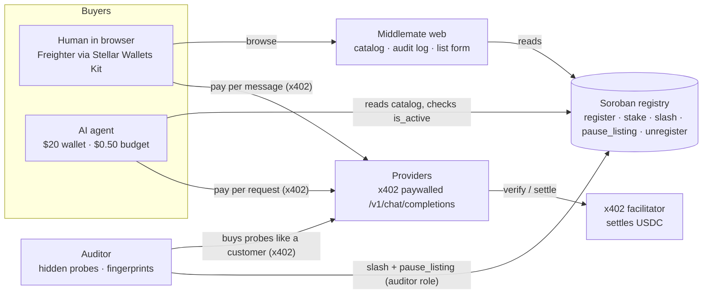

# Middlemate

**A marketplace where AI agents and people pay per request for LLM inference on Stellar, and providers who lie about what they serve lose their stake.**

Built in 24 hours for HackMeridian 2026 (Genesis path, Stellar Composed). Everything runs on **Stellar testnet**.

## The problem

x402 lets anyone sell an API per request: no accounts, no API keys. Agents are starting to buy that way on their own. But a buyer can't tell whether the provider is honest: a seller can advertise a large model, serve a tiny one and keep the difference. Agents buying thousands of requests won't notice. Today's catalogs list services; nobody verifies them.

## How it works



1. **Providers stake.** To list an endpoint, a provider declares the model it serves and a price, and locks USDC in the registry contract (`register`, `stake`).
2. **Buyers pay per request.** Humans pay from Freighter in the browser. The agent pays from its own wallet under a $0.50 spending policy, although the wallet holds more. Payments go **directly to the provider** over x402 (Soroban auth-entry signing of a USDC transfer); Middlemate is never a middleman.
3. **The auditor catches liars.** It is a paying customer like any other. It sends randomized hidden probes:
   - *checkable* probes with known answers (multi-step arithmetic, strict formatting, extraction)
   - *fingerprint* probes, whose answers are embedded and compared with answers from reference models we can query (MiniMax-M2.7 via API, `llama3.2:3b` and `qwen2.5:0.5b` via Ollama)

   Score = 70% fingerprint match with the claimed model plus 30% checkable accuracy. A verdict needs at least 5 scored probes.
4. **Cheaters get slashed.** Below 60/100, the auditor (the only wallet holding the `auditor` role) calls `slash` (the full stake goes to the treasury) and `pause_listing`. The card turns red, then disappears, and the agent reroutes to an honest provider.

### Seed listings (all run by us)

| Listing | Claims | Actually serves | Price |
|---|---|---|---|
| Provider A | MiniMax-M2.7 | MiniMax API | $0.02 |
| Provider B | llama3.2:3b | Ollama llama3.2:3b | $0.004 |
| **CheapMax** (the cheater) | MiniMax-M2.7 | Ollama **qwen2.5:0.5b** | $0.012 |

Calibration over 3 rounds: Provider A scored 83/100/83, Provider B 70/85/85, and CheapMax 0/0/0 (every fingerprint probe matched qwen2.5:0.5b at similarity ≈1.0). With the recorded Claude reference added (`pnpm calibrate`, 2026-10-25), MiniMax still matched itself on 6/7 fingerprint probes, Llama and qwen on 7/7, and no answer landed nearest Claude, so listing the qwen endpoint as Claude Opus 5.5 is slashed the same way.

## Proof on testnet

- Registry contract: [`CCW4UFJ7MSNSWOQWZWG3XOF2IVVWVRINK3YCEROH6PDO4LW5ZPA6ELUA`](https://stellar.expert/explorer/testnet/contract/CCW4UFJ7MSNSWOQWZWG3XOF2IVVWVRINK3YCEROH6PDO4LW5ZPA6ELUA). The transactions below ran on the first version, [`CAHJN3…SH2D`](https://stellar.expert/explorer/testnet/contract/CAHJN3HANWQVJUPQO43PXLCCK4ZAA2Y2EOJYTI7WJAO4WYWFB34GSH2D), which had no `unregister`.
- Additional multi-listing registry: [`CCRBI5…EUXT`](https://stellar.expert/explorer/testnet/contract/CCRBI5SWFCRIFPTJPEEWRO3I6U7DYULTXZXLZFYKOZCWZAGFTPDWEUXT), configured as `LISTING_REGISTRY_CONTRACT_ID`. [Deployment transaction](https://stellar.expert/explorer/testnet/tx/a64cba79b967b8f283be14dcd987a58e9530ae51b0a0bc51ab3450ad5b6ea679).
- First x402 payment (agent → provider): [`0ddff7b0…`](https://stellar.expert/explorer/testnet/tx/0ddff7b02f53dcfec78df221ed49c7a32b73118bc4e1c00d63aaf23f91ce4c74)
- Human payment from Freighter in the browser: [`5a602447…`](https://stellar.expert/explorer/testnet/tx/5a6024470f23f42c49ea21a0eeee8ac9f56074787e34f951e7430760d5e9b3b4)
- **CheapMax slashed by the auditor**: [`abfa5a43…`](https://stellar.expert/explorer/testnet/tx/abfa5a43b63a91bb5acf34b8025615d581624b1a8227c7e81cddc3422214fb4c), delisted: [`e6fcbae4…`](https://stellar.expert/explorer/testnet/tx/e6fcbae4e4730e06c409d1169d62aec8c4c4106f56560aa9b1b3f4ce6880cf30)

## Stellar integration

| Layer | What we use |
|---|---|
| Payments | x402 `exact` scheme on `stellar:testnet` (`@x402/express`, `@x402/fetch`, `@x402/stellar` 2.28), USDC SAC, fee-sponsored settlement |
| Contract | Soroban (soroban-sdk 28) with **OpenZeppelin Stellar Contracts 0.8**: Access Control (`auditor` role, `#[only_role]`), Pausable (registry-wide emergency stop) |
| Staking | Stellar Asset Contract (USDC) transfers into and out of the registry |
| Wallets | **Freighter** via Stellar Wallets Kit: `signAuthEntry` for x402, `signTransaction` for register/stake |

## Model registry and audit economics

- **Only verifiable models can earn trust.** The listing form offers a dropdown of the models the auditor can check (one registry in `@tb/config`: MiniMax-M2.7, llama3.2:3b, qwen2.5:0.5b). "Other" is allowed only with an explicit acknowledgement. Such listings carry an *Unverifiable model* warning and no trust score, the agent skips them by default, and they are never slashed.
- **An audit costs money on both sides.** The auditor pays every probe like a customer (recorded per audit in the log: catching CheapMax costs about $0.07 of probes, against a $5 stake). It also pays for reference inference from hosted models (MiniMax). Reference answers are cached on disk per prompt for 24 h, so a round of audits shares one set of reference calls. In production, slashed stakes in the treasury plus a listing fee would fund auditing.

## Run it

Requirements: Node 25+, pnpm, Rust with `wasm32v1-none`, stellar-cli 28, Ollama, and a MiniMax API key.

```bash
pnpm install
ollama pull llama3.2:3b && ollama pull qwen2.5:0.5b && ollama pull nomic-embed-text
./scripts/setup-keys.sh                     # 7 testnet identities, funded, with USDC trustlines → .env
echo 'MINIMAX_API_KEY=…' >> .env
# send testnet USDC (faucet.circle.com): 6 to each provider, 1 to the auditor, 0.50 to the agent
pnpm check-env                              # balances, Ollama models, MiniMax key
./scripts/deploy-registry.sh                # deploys the contract, writes REGISTRY_CONTRACT_ID
pnpm seed                                   # registers and stakes the three listings
pnpm dev                                    # web :3000, providers :4001, auditor :4002
pnpm agent                                  # the agent buys a summary
pnpm agent --try-overspend                  # the budget rejects a $2.00 job
pnpm demo:reset                             # reset legacy listings; withdraw new listings from Dashboard first
```

Tests: `pnpm test` and `cargo test -p registry`. The video walkthrough and weather verification steps are in [`docs/demo-runbook.md`](docs/demo-runbook.md).

Shared reviews, reports and audit history use Supabase. Follow [`docs/supabase-setup.md`](docs/supabase-setup.md), run the versioned SQL migration, configure the root `.env`, then use `pnpm community:check` and optionally `pnpm community:import-audits`. User reviews, observed technical reliability and MET Norway concordance are separate signals. Community actions use a wallet-signed message; API sanctions require human moderation and a separate signed approval for chain actions.

## Honest limits

- **Community notification counts require a verified wallet session** and migration `202610260002_community_reads.sql`. They cover provider reviews, reports and completed moderation decisions; they refresh every 10 seconds in the open dashboard and clear only on explicit acknowledgement.

- **The audit is statistical.** It can produce false positives and false negatives. MiniMax answers vary between runs (one of Provider A's probes landed nearest qwen), which is why the score blends several probes and a verdict needs at least 5 of them.
- **A smart cheater could detect probes**, or forward probes to the real model while serving cheap answers to everyone else. Randomized prompts drawn from a pool, plus probes paid like normal traffic, reduce this but don't remove it.
- **We can only verify models we can query as a reference.** A listing that claims anything else is marked *Unverifiable* and is never slashed. Hosted closed models can be added the same way MiniMax is (query the vendor's official API as the reference), given an API key.
- **Claude's reference is a recording, not a live model.** We have no Claude API key, so `pnpm record:claude` asked Claude Opus 5.5 each fingerprint probe once through the Claude Code CLI (`apps/auditor/references/claude-opus-5-5.json`, dated inside). It only covers the current probe set (a new probe must be re-recorded, and a test fails until it is), and it is one sample of a model whose answers vary, so an honest Claude listing would score lower than a live reference would give it. In the demo only the cheater claims Claude. `pnpm calibrate` checks that no other demo backend fingerprints as Claude.
- **A listing's price is read from its endpoint once, when it is listed.** `/list` calls the endpoint unpaid and registers the price from its x402 402 answer, so the listed and charged prices start equal. A provider can raise its price afterwards: buyers and the auditor still refuse to pay more than the listed price, so its requests fail rather than overcharge. The auditor then can't score it, shows it as *Not scored* (never a trust number), and retries the entry audit up to 3 times, a minute apart. Charging more than the listed price is not slashed yet.
- **Cached references trade freshness for cost.** A provider whose model changes behaviour is compared against answers up to 24 h old.
- **The model registry is off-chain** (the contract is frozen for the hackathon). An on-chain, governed registry is future work.
- **The seed providers are ours**, including the cheater. Providers and auditor references share one local Ollama instance; in production the reference would be hosted independently.
- **The agent's spending cap is enforced in the agent's code, off-chain.** The demo agent's wallet holds about $20 while its policy allows $0.50, and it refuses any 402 asking more than the registered price. A compromised agent process could ignore that check. The on-chain version (an OpenZeppelin smart account with a spending-limit policy) is blocked today by an x402 facilitator bug with policy events ([x402#3352](https://github.com/x402-foundation/x402/issues/3352)).
- **The facilitator is self-hosted** (in-process, built from the official x402 libraries, with our admin key paying fees) rather than the hosted OpenZeppelin facilitator, which requires an API key.
- **Multiple listings use an additional contract**, configured by `LISTING_REGISTRY_CONTRACT_ID`. Use the deployed public ID from `.env.example`, or deploy a separate instance with `pnpm deploy:listings` when that variable is unset. The existing `REGISTRY_CONTRACT_ID`, listings, and stakes stay in place. The catalog and dashboard read both through `@tb/registry-client`. New registrations atomically create and stake a listing with one wallet approval. Names, stake, audit identity, and exit state belong to the individual listing ID.
- **Exit cooldown is 10 seconds for the hackathon.** New listings remain available during that onchain grace period, then stop routing. The owner signs a second transaction to withdraw remaining stake; auditor slashing can still occur before withdrawal. The admin can change `set_exit_cooldown` on the additional contract for future exits. Ten seconds is too short for production auditing. Legacy `unregister` still refunds immediately; existing deployed behavior is preserved.
- **Dashboard payments are confirmed direct USDC contract transfers**, limited to RPC retention (about seven days). The reader supports the three/four-topic SAC event formats, map amounts and empty scan pages, and incrementally caches chain history per wallet. Classic funding payments and registry transfers are excluded by checking the transaction envelope. Several listings sharing a wallet cannot have revenue attributed to a specific endpoint from a plain transfer alone; unrelated direct SAC transfers can still appear. HTTP request outcomes are not proven by these transfers.
- **Listing enumeration is unpaginated for the hackathon.** The registry retains retired listing history; a larger deployment needs paginated storage/indexing to stay within ledger entry and RPC resource limits.
- **Weather audits measure forecast agreement, not fraud.** Five paid probes compare declared canonical fields with MET Norway, using unit normalization and published tolerances. The reference is a forecast service without an SLA; unavailable references and fewer than five comparable probes are inconclusive. A poor score can open a review case in Supabase, but never automatically warns or slashes. Extra fields are excluded. Existing LLM enforcement is unchanged.
- **Shared community persistence requires Supabase configuration.** Reviews, reports, private replies, decisions and audits are stored in the configured namespace. RLS denies browser access; backend authorization verifies wallet ownership and case permissions. Without configuration the existing local audit file remains usable and community actions are disabled. Local audit history can be imported explicitly. Shared audits cannot be erased through demo reset.
- **Weather demos call live MET Norway data.** `pnpm demo:weather` starts four local endpoints on ports 4003–4006 and does not list them automatically. Each onchain registration requires wallet approval. Browser, agent and auditor send `x-tb-listing-id`; the shared demo host verifies the listing, endpoint and active stake against the registry, then requests the registered price and pays the registered owner through x402. A unique active registration also routes correctly without that header; ambiguous requests are rejected. Unregistered demos still pay their `TB_WEATHER_*` fixture identities. Payments made before this routing fix remain with the original fixture wallet and appear to buyers as legacy demo payouts; they are never counted as the listing owner's earnings. The app caches MET Norway responses according to its HTTP expiry headers, identifies itself with a User-Agent, rounds coordinates to four decimals and links to the source/license. The response values are forecasts, not observations.
- **Community moderation is centralized for the hackathon.** Configured moderator wallets examine evidence and public reasons, and cannot adjudicate their own provider/buyer cases. Warning/slash decisions wait for a provider reply or the recorded response deadline. `MODERATION_RESPONSE_SECONDS` defaults to 24 hours; use 60 for a demo. Separate signed approval authorizes the backend auditor to execute slash then pause. Database/chain commits are not atomic; a crash between a transaction and its saved hash requires operator review. A 10-second registry exit does not guarantee that stake remains available throughout moderation. `WEATHER_WARNING_THRESHOLD` is obsolete; `WEATHER_TRUST_THRESHOLD` configures concordance only.
- **Weather grades reflect the size of deviations.** A comparable numeric field earns `max(0, 100 - 20 × error / tolerance)`; the audit grade is the mean rounded down. Exact values earn 100, one tolerance unit earns 80, and missing or physically invalid provider values earn 0. Scores express agreement with MET Norway, not a probability of honesty. NearCast deliberately makes small valid deviations and should pass with less than 100; False Front should fail. Old audits keep their original binary-tolerance grade and are identified as historical grading in the dashboard. A new paid audit is needed to produce a new grade.
- **Verified reviews are wallet-based, not person-based.** One active review per wallet/listing needs a confirmed successful non-audit call; changing it needs a newer call. Self-review is prohibited and red votes require a reason. This raises Sybil cost without preventing coordinated wallets or provider/buyer collusion. Votes never directly sanction a provider.
- **Call history is observed and payment-backed.** The gateway binds a selected listing to the actual upstream request and confirms its USDC settlement onchain. Old transfers without endpoint attribution do not unlock reviews. Request/response bodies are not persisted; observed response/format statistics are samples, not uptime guarantees. The gateway permits public HTTPS and documented local demos, blocks other private endpoints and redirects, and limits requests/responses to 64 KB/2 MB. Receipt persistence errors never retry a payment; a signed recovery token can save the receipt within an hour while the page remains open.
- **Wallet community login uses SEP-53 Ed25519 message signatures**, single-use expiring challenges and HttpOnly sessions. Contract wallets and multisig identity login are not implemented. Supabase server keys remain private; expired session/challenge cleanup and stronger distributed abuse throttling are future operational work.
- **Removing a listing does not stop its HTTP server.** New listing owners request removal and withdraw from Dashboard; existing legacy owners can unregister there. The API host remains under the provider's control.
- **Wallets:** the live marketplace is on Stellar Testnet and currently uses Freighter. MetaMask's available Stellar adapter supports PUBNET only, so it cannot safely sign this app's Testnet payment or registry operations yet.
- **Wallet restoration remembers the wallet choice only.** On reload the app silently reads the current authorized Freighter address; every transaction still requires wallet signing. Revoked permissions or unavailable browser storage can require reconnecting. Explicit disconnect clears the remembered choice.
- **Testnet only.** Nothing here has been audited.

## What's next

- On-chain agent spending caps through OpenZeppelin smart accounts once the facilitator fix lands.
- Add more API categories only with explicit request/response contracts and category-specific audit rules.
- Reputation over time instead of single-round verdicts, unstake with a cooldown, and audits that third parties can run and challenge.
- A trust layer any x402 seller can plug into, not just this catalog.
